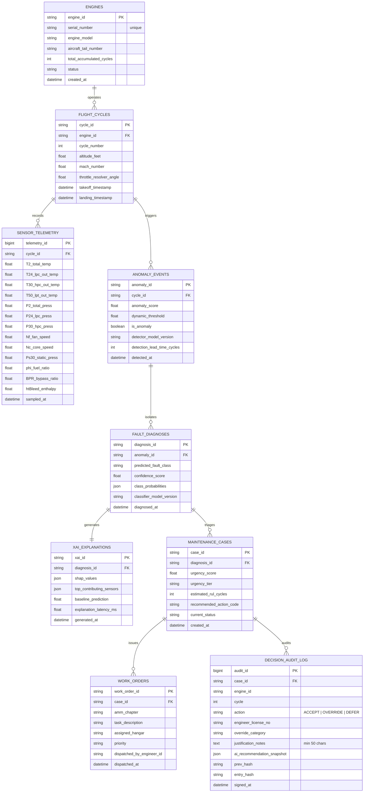

# VortexPHM-AI: Aero-Engine Telemetry Anomaly Detection & Decision Support Engine
## Comprehensive Database Design & Data Architecture

---

> **Scope note.** This is the **target (PostgreSQL-first) schema** for a production deployment. The demonstration build implements the `decision_audit_log` table (SQLite by default, PostgreSQL via `DATABASE_URL`) and serves telemetry/diagnoses from a compact Parquet demo fleet. The DDL below uses PostgreSQL types (`JSONB`, `BIGSERIAL`, `TIMESTAMP WITH TIME ZONE`); SQLAlchemy maps them to SQLite equivalents (`JSON`, integer primary key, plain timestamps).

---

## 1. Entity-Relationship Diagram (ERD)

The relational schema is structured to ensure strict referential integrity, high-throughput time-series ingest, and an immutable, cryptographically verifiable audit trail of human engineer decisions:



---

## 2. Detailed Table DDL & Schema Definitions

### 2.1 Table: `engines`
Stores master configuration and lifecycle status of each aero-engine in the fleet:

```sql
CREATE TABLE engines (
    engine_id VARCHAR(36) PRIMARY KEY,
    serial_number VARCHAR(64) NOT NULL UNIQUE,
    engine_model VARCHAR(64) NOT NULL, -- e.g., 'CFM-LEAP-1A', 'GE90-115B'
    aircraft_tail_number VARCHAR(32) NOT NULL, -- e.g., 'N842AA'
    total_accumulated_cycles INTEGER NOT NULL DEFAULT 0,
    status VARCHAR(32) NOT NULL DEFAULT 'ACTIVE', -- 'ACTIVE', 'AOG', 'IN_MAINTENANCE', 'RETIRED'
    created_at TIMESTAMP WITH TIME ZONE DEFAULT CURRENT_TIMESTAMP,
    updated_at TIMESTAMP WITH TIME ZONE DEFAULT CURRENT_TIMESTAMP
);

CREATE INDEX idx_engines_status ON engines(status);
CREATE INDEX idx_engines_tail ON engines(aircraft_tail_number);
```

### 2.2 Table: `flight_cycles`
Logs operational boundary conditions for every recorded flight takeoff-to-touchdown cycle:

```sql
CREATE TABLE flight_cycles (
    cycle_id VARCHAR(36) PRIMARY KEY,
    engine_id VARCHAR(36) NOT NULL REFERENCES engines(engine_id) ON DELETE CASCADE,
    cycle_number INTEGER NOT NULL,
    altitude_feet REAL NOT NULL,
    mach_number REAL NOT NULL,
    throttle_resolver_angle REAL NOT NULL,
    takeoff_timestamp TIMESTAMP WITH TIME ZONE NOT NULL,
    landing_timestamp TIMESTAMP WITH TIME ZONE NOT NULL,
    CONSTRAINT uq_engine_cycle UNIQUE (engine_id, cycle_number)
);

CREATE INDEX idx_flight_cycles_engine ON flight_cycles(engine_id, cycle_number);
```

### 2.3 Table: `sensor_telemetry`
*Stores per-cycle aggregated, regime-corrected channels. Channels beyond the 13 listed below (C-MAPSS 21, N-CMAPSS 14) can be added as columns or an `extra_channels JSONB` field.*

High-density time-series telemetry table capturing normalized thermodynamic sensor readings:

```sql
CREATE TABLE sensor_telemetry (
    telemetry_id BIGSERIAL PRIMARY KEY,
    cycle_id VARCHAR(36) NOT NULL REFERENCES flight_cycles(cycle_id) ON DELETE CASCADE,
    T2_total_temp REAL NOT NULL,
    T24_lpc_out_temp REAL NOT NULL,
    T30_hpc_out_temp REAL NOT NULL,
    T50_lpt_out_temp REAL NOT NULL,
    P2_total_press REAL NOT NULL,
    P24_lpc_press REAL NOT NULL,
    P30_hpc_press REAL NOT NULL,
    Nf_fan_speed REAL NOT NULL,
    Nc_core_speed REAL NOT NULL,
    Ps30_static_press REAL NOT NULL,
    phi_fuel_ratio REAL NOT NULL,
    BPR_bypass_ratio REAL NOT NULL,
    htBleed_enthalpy REAL NOT NULL,
    sampled_at TIMESTAMP WITH TIME ZONE DEFAULT CURRENT_TIMESTAMP
);

CREATE INDEX idx_telemetry_cycle ON sensor_telemetry(cycle_id);
```

### 2.4 Table: `anomaly_events`
Stores outputs of the unsupervised anomaly detection model:

```sql
CREATE TABLE anomaly_events (
    anomaly_id VARCHAR(36) PRIMARY KEY,
    cycle_id VARCHAR(36) NOT NULL REFERENCES flight_cycles(cycle_id) ON DELETE CASCADE,
    anomaly_score REAL NOT NULL, -- in range [0.0, 1.0]
    dynamic_threshold REAL NOT NULL, -- calibrated threshold (target persistent-alarm FAR), same [0,1] scale; EWMA + 3sigma kept as baseline
    is_anomaly BOOLEAN NOT NULL,
    detector_model_version VARCHAR(64) NOT NULL,
    detection_lead_time_cycles INTEGER, -- Lead time relative to failure
    detected_at TIMESTAMP WITH TIME ZONE DEFAULT CURRENT_TIMESTAMP
);

CREATE INDEX idx_anomaly_flag ON anomaly_events(is_anomaly);
CREATE INDEX idx_anomaly_cycle ON anomaly_events(cycle_id);
```

### 2.5 Table: `fault_diagnoses`
Stores output from the supervised multi-class fault classification model:

```sql
CREATE TABLE fault_diagnoses (
    diagnosis_id VARCHAR(36) PRIMARY KEY,
    anomaly_id VARCHAR(36) NOT NULL REFERENCES anomaly_events(anomaly_id) ON DELETE CASCADE,
    predicted_fault_class VARCHAR(64) NOT NULL, -- 'NOMINAL', 'FAULT_HPC_EFFICIENCY', 'FAULT_FAN_LPC', 'FAULT_HPT_THERMAL', 'FAULT_SENSOR_DRIFT', 'UNCERTAIN_ANOMALY'
    confidence_score REAL NOT NULL,
    class_probabilities JSONB NOT NULL, -- e.g., {"NOMINAL": 0.02, "FAULT_HPC_EFFICIENCY": 0.91, ...}
    classifier_model_version VARCHAR(64) NOT NULL,
    diagnosed_at TIMESTAMP WITH TIME ZONE DEFAULT CURRENT_TIMESTAMP
);

CREATE INDEX idx_diagnosis_fault ON fault_diagnoses(predicted_fault_class);
```

### 2.6 Table: `xai_explanations`
Stores SHAP feature attribution data providing transparent root-cause evidence:

```sql
CREATE TABLE xai_explanations (
    xai_id VARCHAR(36) PRIMARY KEY,
    diagnosis_id VARCHAR(36) NOT NULL UNIQUE REFERENCES fault_diagnoses(diagnosis_id) ON DELETE CASCADE,
    shap_values JSONB NOT NULL, -- Dictionary of sensor -> SHAP value
    top_contributing_sensors JSONB NOT NULL, -- Ordered array of top-5 sensors
    baseline_prediction REAL NOT NULL,
    explanation_latency_ms REAL NOT NULL,
    generated_at TIMESTAMP WITH TIME ZONE DEFAULT CURRENT_TIMESTAMP
);
```

### 2.7 Table: `maintenance_cases`
Represents an actionable triage ticket in the maintenance control queue:

```sql
CREATE TABLE maintenance_cases (
    case_id VARCHAR(36) PRIMARY KEY,
    diagnosis_id VARCHAR(36) NOT NULL REFERENCES fault_diagnoses(diagnosis_id) ON DELETE CASCADE,
    urgency_score REAL NOT NULL, -- Scale 0.0 to 100.0
    urgency_tier VARCHAR(16) NOT NULL, -- 'TIER_1_CRITICAL' (U>=70), 'TIER_2_ELEVATED' (40<=U<70), 'TIER_3_MONITOR' (U<40)
    estimated_rul_cycles INTEGER NOT NULL,
    recommended_action_code VARCHAR(32) NOT NULL, -- 'ACT-HPC-BORE', etc.
    current_status VARCHAR(32) NOT NULL DEFAULT 'OPEN', -- 'OPEN', 'ACCEPTED', 'OVERRIDDEN', 'RESOLVED'
    created_at TIMESTAMP WITH TIME ZONE DEFAULT CURRENT_TIMESTAMP,
    updated_at TIMESTAMP WITH TIME ZONE DEFAULT CURRENT_TIMESTAMP
);

CREATE INDEX idx_cases_urgency ON maintenance_cases(urgency_score DESC);
CREATE INDEX idx_cases_status ON maintenance_cases(current_status);
```

### 2.8 Table: `decision_audit_log` (Tamper-Evident Audit Trail)
Stores **every** engineer action (ACCEPT, OVERRIDE, DEFER), not only overrides. Each row commits to the previous row through a SHA-256 hash chain.

```sql
CREATE TABLE decision_audit_log (
    audit_id BIGSERIAL PRIMARY KEY,
    case_id VARCHAR(36) REFERENCES maintenance_cases(case_id) ON DELETE RESTRICT,
    engine_id VARCHAR(64) NOT NULL,
    cycle INTEGER NOT NULL,
    action VARCHAR(16) NOT NULL CHECK (action IN ('ACCEPT','OVERRIDE','DEFER')),
    engineer_license_no VARCHAR(32) NOT NULL,
    override_category VARCHAR(64),
    justification_notes TEXT NOT NULL CHECK (char_length(justification_notes) >= 50),
    ai_recommendation_snapshot JSONB NOT NULL, -- fault class, urgency, RUL, cost, AMM tasks shown to the engineer
    prev_hash CHAR(64) NOT NULL,               -- entry_hash of the previous row ('0'*64 for the first)
    entry_hash CHAR(64) NOT NULL,              -- SHA-256(prev_hash | canonical_json(payload))
    signed_at TIMESTAMP WITH TIME ZONE DEFAULT CURRENT_TIMESTAMP
);

-- Append-only enforcement (PostgreSQL)
CREATE OR REPLACE FUNCTION audit_block() RETURNS trigger AS $$
BEGIN RAISE EXCEPTION 'decision_audit_log is append-only'; END; $$ LANGUAGE plpgsql;
CREATE TRIGGER audit_no_mod BEFORE UPDATE OR DELETE ON decision_audit_log
FOR EACH ROW EXECUTE FUNCTION audit_block();
```
SQLite equivalent: `BEFORE UPDATE` and `BEFORE DELETE` triggers that `SELECT RAISE(ABORT, 'append-only')`. The integrity endpoint `GET /api/v1/audit/verify` recomputes the chain and returns the first broken entry id.

---

## 3. Data Integrity, Indexing & Retention Strategy

1. **Write Performance**: SQLite runs in WAL mode for the demo; for multi-user production use PostgreSQL with connection pooling.
2. **Audit Immutability**: (a) database triggers reject UPDATE/DELETE, (b) a hash chain makes any out-of-band edit detectable, (c) `GET /audit/verify` plus an automated tamper test (drop the trigger, edit a row, verify reports the broken id), (d) in production, additionally revoke UPDATE/DELETE privileges from the application role and anchor the latest hash externally.
3. **Hosting caveat**: on hosts with ephemeral disks the SQLite file is lost on redeploy; use a persistent disk or a managed PostgreSQL via `DATABASE_URL`.
4. **Partitioning**: When deployed on PostgreSQL, `sensor_telemetry` is partitioned by range on `sampled_at` (monthly partitions) for large historical volumes.
