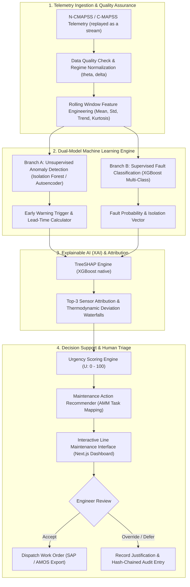

# VortexPHM-AI: Aero-Engine Telemetry Anomaly Detection & Decision Support Engine
## Comprehensive Project Overview

---

## 1. Executive Summary
**VortexPHM-AI** is an industrial-grade Prognostics and Health Management (PHM) and Decision Support System (DSS) engineered for commercial and defense turbofan aero-engines. In contemporary commercial aviation, unscheduled engine removals (UER) and In-Flight Shutdowns (IFSD) represent catastrophic operational disruptions, generating unexpected maintenance expenses ranging between **$150,000 and $1,200,000 per event**, excluding passenger re-accommodation, flight cancellations, and airframe grounding fees (AOG).

Modern commercial turbofans (such as the CFM LEAP, GE90, Trent series, and Pratt & Whitney PW1000G) generate high-frequency multivariate telemetry streams across extreme operational environments. Conventional Condition-Based Maintenance (CBM) predominantly relies on static threshold-based monitoring, single-sensor alarms, and periodic scheduled overhauls. These traditional approaches suffer from two fatal operational flaws:
1. **Excessive False Alarm Rates (FAR)** induced by dynamic atmospheric and power-demand transients (takeoff, climb, cruise, reverse thrust).
2. **Late Detection Lead Time**, alerting maintenance crews only after severe mechanical or thermodynamic damage has already propagated.

**VortexPHM-AI** solves this challenge by unifying:
- **Unsupervised Anomaly Detection** for early warning and maximal detection lead time.
- **Supervised Multi-Class Fault Classification** for granular physical fault localization.
- **Explainable AI (XAI)** to dismantle black-box opacity and provide line engineers with auditable root-cause evidence.
- **Human-in-the-Loop Maintenance Decision Support** to calculate operational urgency scores, recommend actionable maintenance tasks, and maintain a certified digital audit trail of engineer acceptances and overrides.

---

## 1.1 Data Scope & Honest Limitations

| Topic | Decision |
| :--- | :--- |
| **Primary dataset** | **N-CMAPSS** (NASA): flight-by-flight telemetry with ground-truth health parameters for Fan, LPC, HPC, HPT and LPT. Supplies real fault-mode labels for the supervised classifier. |
| **Benchmark dataset** | **C-MAPSS FD001-FD004**: run-to-failure trajectories used for RUL benchmarking against the literature, lead-time evaluation and the six-regime normalization test (FD002/FD004). C-MAPSS has no fault-mode labels. |
| **Synthetic class** | `FAULT_SENSOR_DRIFT` is the only synthetic class. It is injected into clean nominal segments (virtual units), never on top of real degradation. |
| **Prototype status** | VortexPHM-AI is an advisory decision-support prototype built on public simulation data. It is not certified and makes no airworthiness decisions. |
| **Reported numbers** | Every metric in this documentation set is produced by the benchmark scripts into `results/`. Example values in wireframes and API samples are illustrative. |

---

## 2. Turbofan Physical Architecture & Degradation Physics

Commercial twin-spool high-bypass turbofans comprise seven primary thermodynamic stations. VortexPHM-AI continuously ingests and normalizes telemetry mapped across these stations:

```
                  ┌────────────────────────────────────────────────────────┐
                  │                      BYPASS DUCT                       │
   AIR INLET      │                                                        │       NOZZLE
═════════════════►│  [FAN] ──► [LPC] ──► [HPC] ──► [BURNER] ──► [HPT] ──► [LPT] ═══════════►
                  │  Station 2 Station 2.4 Station 3  Station 4 Station 4.5 Station 5
                  │                                                        │
                  └────────────────────────────────────────────────────────┘
```

### Primary Monitored Parameters:
- **Station 2 (Fan Inlet)**: Total temperature ($T_2$), total pressure ($P_2$).
- **Station 2.4 (LPC Outlet / HPC Inlet)**: Total temperature ($T_{24}$), total pressure ($P_{24}$).
- **Station 3 (HPC Discharge)**: High-pressure compressor exit temperature ($T_{30}$), static pressure ($Ps_{30}$), total pressure ($P_{30}$).
- **Station 4 / 4.5 (Combustor & HPT)**: Fuel flow ($W_f$), High-pressure turbine inlet/exit temperature.
- **Station 5 (LPT Exhaust)**: Exhaust Gas Temperature ($EGT$ / $T_{50}$), Low-pressure turbine exit total pressure ($P_{50}$).
- **Rotational Spool Dynamics**: Low-pressure spool speed ($N_f$), High-pressure spool speed ($N_c$).
- **Cooling & Bleeds**: HPC bleed air ratio, bypass ratio (BPR), cooling air flow.

### Key Physical Failure Modes Targeted:
1. **High-Pressure Compressor (HPC) Degradation**: Aerodynamic blade erosion, seal degradation, and fouling leading to decreased isentropic efficiency ($\eta_{HPC}$) and reduced mass flow capacity. Evidenced by elevated $T_{30}$ and $EGT$ for equivalent thrust demand.
2. **Fan & Low-Pressure Compressor (LPC) Degradation**: Foreign Object Damage (FOD), leading-edge wear, and blade tip clearance opening. Evidenced by $N_f/N_c$ mismatch and anomalous vibration signatures.
3. **High-Pressure Turbine (HPT) Thermal Distress & Blade Creep**: Hot section degradation caused by thermal cycling, coating spallation, and cooling passage blockage. Evidenced by rapid $EGT$ margin erosion.
4. **Bearing & Lubrication Degradation** *(not represented in the datasets used; listed for completeness, out of scope)*: Bearing race spalling, oil scavenge temperature spikes, and metal chip accumulation.
5. **Sensor Calibration Drift & Bias**: Thermocouple degradation or pressure tap blockage creating phantom anomalies without physical engine deterioration.

---

## 3. High-Level System Architecture & Workflow

The end-to-end operational pipeline seamlessly transitions raw telemetry into certified maintenance decisions:



---

## 4. The Three Core Faculty Objectives & Formal Acceptance Criteria

VortexPHM-AI is strictly architected around the three required academic and industrial milestones:

### Objective 1: Construct a Reproducible Sensor-Feature Dataset
* **Core Goal**: Construct a clean, deterministic, multivariate sensor dataset covering nominal operating regimes and representative fault-onset trajectories.
* **Dataset Foundation**: **N-CMAPSS** (primary: real fault modes and health parameters) plus the **NASA C-MAPSS** benchmark suite (FD001: single condition, HPC degradation; FD002: six conditions, HPC degradation; FD003: single condition, HPC + Fan degradation; FD004: six conditions, multi-fault) for benchmarking.
* **Controlled Injections**: Synthetic sensor drift ($+0.05\% / \text{cycle}$), sudden step-bias, and Gaussian white noise ($SNR \ge 32\text{ dB}$, variance-based) injected into virtual units copied from nominal segments, with engine-level train/test separation.
* **Measurable Acceptance Criteria**:
  - **Reproducibility**: 100% deterministic generation using fixed pseudo-random seeds (`SEED=42`).
  - **Completeness**: Zero missing values ($\text{Completeness} \ge 99.98\%$) across all ingested sensor channels and operating-condition descriptors.
  - **Physical Validity**: Automated sanity checks ensuring all thermodynamic parameters obey gas turbine thermodynamic bounds (N-CMAPSS: $P_2 < P_{24} < P_{30}$ and $T_2 < T_{24} < T_{30}$; C-MAPSS: $P_2 < P_{15} < P_{30}$ and $T_2 < T_{24} < T_{30}$).

### Objective 2: Dual-Model Comparison: Anomaly Detection vs. Supervised Classification
* **Core Goal**: Empirically evaluate and compare the strengths of unsupervised anomaly detection against supervised fault classification rather than relying on a single aggregate metric.
* **Measurable Acceptance Criteria**:
  - **Early Detection Lead Time ($T_{\text{lead}}$)**:
    $$T_{\text{lead}} = T_{\text{failure}} - T_{\text{detect}}$$
    Unsupervised Anomaly Detection must detect anomalous degradation trends at least **35 flight cycles** prior to functional operational limits (headline figure on C-MAPSS; on N-CMAPSS also reported as a percentage of engine life because lifetimes are shorter). Detection is a persistent alarm: at least 3 flags in the last 5 cycles.
  - **False Alarm Rate (FAR)**:
    $$\text{FAR} = \frac{\text{False Positives}}{\text{Nominal Flight Cycles}} \le 2.0\%$$
    under nominal un-degraded operating regimes (cycle-level, persistent-alarm basis; engine-level rate also reported).
  - **Fault Identification Quality**:
    Supervised classifier must attain **Macro-F1 $\ge 0.91$** and **Precision $\ge 0.90$** across the 5 operating states (NOMINAL + 4 fault classes), evaluated on engines held out of training.
  - **Comparative Trade-off Analysis**: Deliver multi-dimensional radar plots, ROC curves, and Lead-Time vs False-Alarm trade-off curves documenting when to trust unsupervised screening versus supervised diagnostics.

### Objective 3: Integrated Human-in-the-Loop Maintenance Decision Interface
* **Core Goal**: Build an operational maintenance cockpit that translates complex machine learning outputs into prioritized, actionable engineering interventions.
* **Measurable Acceptance Criteria**:
  - **Urgency Prioritization ($U \in [0, 100]$)**:
    $$U = 100 \cdot \left[ 0.35 \cdot S_{\text{anom}} + 0.35 \cdot S_{\text{crit}} + 0.30 \cdot \left(1 - \frac{\text{RUL}}{\text{RUL}_{\text{ref}}}\right) \right]$$
    with $S_{\text{crit}} = \sum_c P(c)\cdot C_c$ (HPT 1.0, HPC 0.8, Fan/LPC 0.6, Sensor Drift 0.35, Nominal 0) and $\text{RUL}_{\text{ref}} = 125$ cycles. Tiers: Tier 1 Critical $U \ge 70$, Tier 2 Elevated $40 \le U < 70$, Tier 3 Monitor $U < 40$. Fleet queue re-ranking in under 100 ms. See `Canonical_Parameters.md`.
  - **Explainability Transparency**: Every alert displays a SHAP waterfall breakdown identifying the top-3 physical drivers (e.g., *HPC exit temperature $T_{30}$ deviation (+18.4 K), High-pressure spool speed $N_c$ drop (-42 RPM)*).
  - **Engineer Override Auditability**: 100% of engineer actions (`ACCEPT`, `OVERRIDE`, `DEFER`) are recorded with mandatory justification tags, engineer ID, timestamp, and stored in a hash-chained, append-only SQLite/PostgreSQL audit table (each entry commits to the previous entry's SHA-256; database triggers block UPDATE/DELETE).

---

## 5. Technology Stack Summary

| Layer | Technology | Rationale |
| :--- | :--- | :--- |
| **Frontend UI** | Next.js 15 (App Router), React 19, TailwindCSS, next-themes, Lucide Icons, Recharts, Three.js (react-three-fiber) | Dual-theme (dark default + light) Titanium Industrial console with an interactive procedural 3D engine; laptop-optimised. |
| **Backend API** | Python 3.12/3.13, FastAPI, Uvicorn, Pydantic v2 | High-throughput asynchronous REST endpoints, automated OpenAPI generation, sub-20ms serialization overhead. |
| **Machine Learning** | PyTorch (offline LSTM autoencoder), Scikit-Learn (Isolation Forest), XGBoost | Tree ensembles for tabular telemetry features and a deep autoencoder benchmark; the slim serving image excludes PyTorch. |
| **Explainable AI** | XGBoost native TreeSHAP (`pred_contribs`), SHAP library for offline global plots, SciPy | Fast local attribution values satisfying additive feature attribution axioms (efficiency, symmetry, additivity). |
| **Data & Storage** | Pandas, NumPy, SQLAlchemy, SQLite / PostgreSQL | Robust tabular preprocessing, relational schema integrity, indexed time-series queries. |
| **Testing & Quality** | Pytest, Flake8, Pydantic validation, Jest | Automated test coverage for data pipeline, model contracts, API endpoints, and UI state management. |

---

## 6. Expected Deliverables & Project Impact
1. **Fully Documented Architecture Suite**: 10 core blueprints covering requirements, architecture, API, database, UI, and testing.
2. **Reproducible Telemetry & Fault Benchmark**: Reproducible build script producing the N-CMAPSS/C-MAPSS feature datasets and injected sensor-drift units with a machine-readable quality report.
3. **Dual-Model Benchmark Report**: Empirical evaluation scripts measuring Lead Time, False Alarm Rate, and Macro-F1.
4. **Operational Next.js Maintenance Cockpit**: Interactive web interface featuring live telemetry charts, urgency triage queues, SHAP feature waterfalls, and engineer override audit controls.
