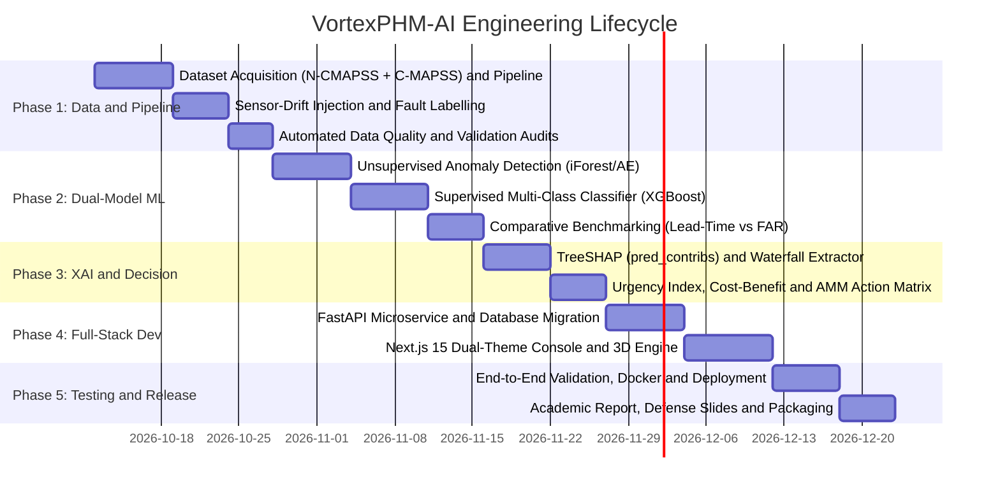

# VortexPHM-AI: Aero-Engine Telemetry Anomaly Detection & Decision Support Engine
## Comprehensive Project Plan & Phased Work Breakdown Structure (WBS)

---

## 1. Phased Execution Roadmap

The engineering implementation of **VortexPHM-AI** is structured into five distinct, sequential phases to guarantee rigorous validation at every milestone:

---

## 2. Detailed Work Breakdown Structure (WBS)

### Phase 1: Telemetry Data Engineering & Quality Assurance (Weeks 1 - 2)
- **Task 1.1**: Download and parse **N-CMAPSS** (primary, real fault-mode labels) and NASA **C-MAPSS** FD001-FD004 (benchmark). Run the inspection script to confirm which health parameters degrade per engine and pick DS files covering Fan, LPC, HPC and HPT with enough engines per class.
- **Task 1.2**: Implement aerodynamic corrections from fan-inlet conditions in native units ($\theta = T_2/518.67\,^\circ$R, $\delta = P_2/14.696$ psia) and per-regime z-scoring fitted on nominal training data only.
- **Task 1.3**: Build the injector: sensor drift (+0.05%/cycle), step bias and Gaussian noise (SNR >= 32 dB) applied to *virtual units* copied from nominal segments, labelled `FAULT_SENSOR_DRIFT`; engine-level split inheritance.
- **Task 1.4**: Automated tests and a machine-readable quality report: completeness ($\ge 99.98\%$), dataset-specific thermodynamic rules (N-CMAPSS $P_2<P_{24}<P_{30}$; C-MAPSS $P_2<P_{15}<P_{30}$), stuck-sensor detection.
- **Deliverable**: `data/processed/*.parquet` feature matrices, `results/quality_report_*.json`, reproducible `build_dataset.py` (fixed seeds).

### Phase 2: Dual-Model ML Engineering & Comparative Benchmarking (Weeks 3 - 4)
- **Task 2.1**: Train and tune unsupervised anomaly detection models (Isolation Forest and Deep LSTM Autoencoder) on nominal trajectories.
- **Task 2.2**: Implement the traditional-CBM baselines (fixed 3-sigma, EWMA) and calibrate detector thresholds on held-out validation engines to a persistent-alarm false-alarm target ($k=3$ of $n=5$ cycles).
- **Task 2.3**: Train the supervised multi-class XGBoost classifier on labels derived from N-CMAPSS health parameters (plus injected sensor-drift units) with engine-level cross-validation and class weighting; train the RUL regressor with residual-based uncertainty.
- **Task 2.4**: Implement the dual-model arbitration handshake (Anomaly Screener gates Classifier).
- **Task 2.5**: Run the formal benchmark: baseline vs Isolation Forest vs LSTM autoencoder (lead time, persistent-alarm FAR), classifier macro-F1/precision/confusion matrix, RUL RMSE and NASA score, plus ablations (regime normalization, rolling features). Results are written to `results/benchmark_*.json`.
  - Detection Lead Time ($T_{\text{lead}} = T_{\text{fail}} - T_{\text{detect}}$ in flight cycles).
  - False Alarm Rate (FAR) under healthy cycles.
  - Multi-class Macro F1-score and confusion matrix.
- **Deliverable**: `backend/artifacts/` (XGBoost JSON, Isolation Forest joblib, meta.json), benchmark JSON files and figures.

### Phase 3: Explainable AI & Maintenance Decision Engine (Weeks 5 - 6)
- **Task 3.1**: Expose exact TreeSHAP through XGBoost `pred_contribs`; benchmark p95 latency against the 120 ms target.
- **Task 3.2**: Build top-3 sensor driver extractor and thermodynamic baseline deviation mapper.
- **Task 3.3**: Implement the composite Urgency Index (weights 0.35/0.35/0.30, tiers 70/40), the probability-weighted criticality, and the cost-benefit overlay (assumption-based constants).
- **Task 3.4**: Define Aircraft Maintenance Manual (AMM) task mapping lookup table.
- **Deliverable**: `src/xai/` and `src/decision_engine/` modules with comprehensive unit test coverage.

### Phase 4: Full-Stack Microservice & Next.js Cockpit (Weeks 7 - 8)
- **Task 4.1**: Build FastAPI backend REST endpoints for telemetry ingestion, diagnosis, XAI, and triage.
- **Task 4.2**: Implement the hash-chained, append-only `decision_audit_log` (SQLite triggers, PostgreSQL option) with `/audit/verify`.
- **Task 4.3**: Scaffold the Next.js 15 App Router project with the dual-theme (dark default + light) Titanium Industrial design system (`UI_Design.md`), Geist fonts and the orange primary accent.
- **Task 4.4**: Implement the interface per `UI_Design.md`:
  - Fleet board: KPI strip, ranked urgency queue and fleet-time slider.
  - Engine cockpit: procedural interactive 3D engine (station selection, orbit/auto-rotate, risk tinting, replay sync, exploded view) with Telemetry / Explain / Decide / Audit tabs.
  - SHAP waterfall, cost-benefit card, AMM task list, decision form with 50-character justification, audit page with hash-chain badge, model governance page.
- **Deliverable**: Functional web interface running on `http://localhost:3000` connected to FastAPI on `http://localhost:8000/api/v1`.

### Phase 5: Verification, Human-in-the-Loop Evaluation & Release (Weeks 9 - 10)
- **Task 5.1**: Conduct end-to-end integration tests simulating 50 concurrent engine telemetry streams.
- **Task 5.2**: Simulate engineer decision workflows and verify audit-trail tamper detection (automated test: remove trigger, edit a row, `/audit/verify` reports the broken entry).
- **Task 5.3**: Package with Docker (slim serving image without PyTorch), `docker compose up` for local full-stack runs, backend on a container host and the frontend on Vercel; pre-warm the backend before presentations and keep a recorded demo as a fallback.
- **Task 5.4**: Author comprehensive academic project documentation, evaluation graphs, and presentation deck.

---

## 3. Risk Assessment & Mitigation Matrix

| Risk ID | Risk Description | Severity | Likelihood | Mitigation Strategy |
| :--- | :--- | :--- | :--- | :--- |
| **RSK-01** | Extreme class imbalance between healthy cycles and rare fault-onset cases. | High | High | Class-weighted training and engine-level cross-validation (no SMOTE on time-series features, which risks leakage); train the anomaly detector exclusively on nominal cycles. |
| **RSK-02** | Atmospheric variations causing false anomaly spikes during climb/descent. | High | Medium | Apply aerodynamic correction factors ($\theta, \delta$ from inlet T2/P2) and per-regime normalization before anomaly scoring. |
| **RSK-03** | TreeSHAP calculation latency exceeding line maintenance SLA ($> 500\text{ ms}$). | Medium | Medium | Use XGBoost native `pred_contribs`, load the booster once at startup, and report p95 latency. |
| **RSK-04** | Line engineers blindly accepting or overriding AI recommendations without reading evidence. | High | Medium | Enforce mandatory technical justification text input (minimum 50 chars) and digital signature before override confirmation. |
| **RSK-05** | Model drift over seasonal weather cycles. | Medium | Low | Future work: PSI/KS drift monitor and retraining trigger; documented as a limitation. |
| **RSK-06** | Too few engines per fault class in the chosen N-CMAPSS files, so cross-validation folds lose a class. | High | Medium | Combine several DS files, merge Fan+LPC (already merged), or drop a class and disclose it. |
| **RSK-07** | N-CMAPSS files too large for laptop RAM (1 Hz data). | Medium | Medium | Stride-sample, process one file at a time, `float32`, aggregate per cycle immediately. |
| **RSK-08** | Free-tier host sleeps or loses the audit database on redeploy. | Medium | High | Persistent disk or managed PostgreSQL, pre-warm before presenting, local Docker and recorded demo as backups. |
| **RSK-09** | Targets (macro-F1 >= 0.91, lead >= 35 cycles) not met on N-CMAPSS. | High | Medium | Report honestly with per-class breakdown, ablations and the % of life metric; tune persistence and window; do not leak to hit numbers. |
