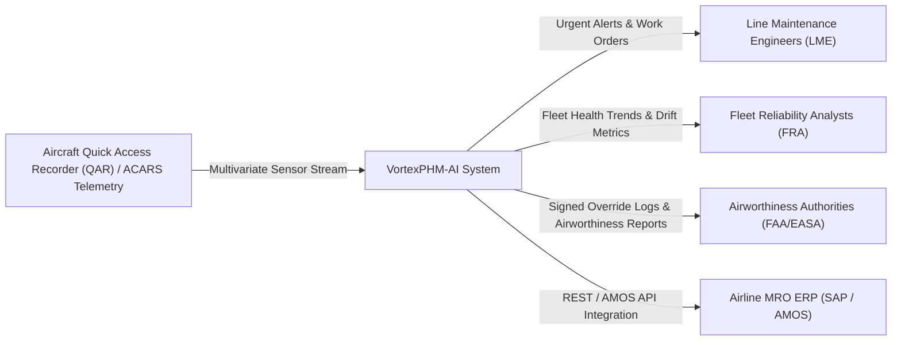
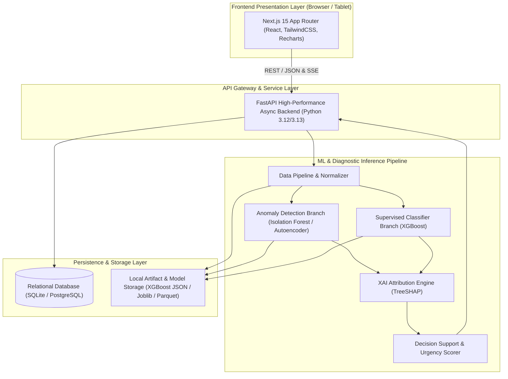
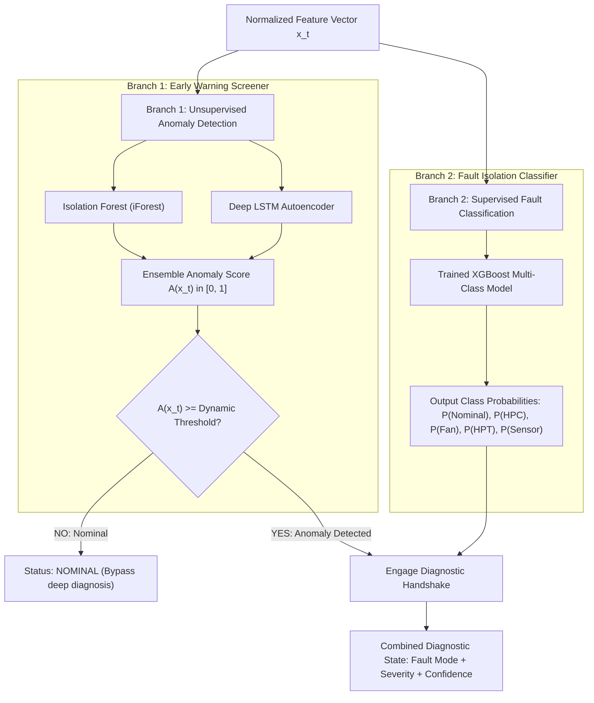

# VortexPHM-AI: Aero-Engine Telemetry Anomaly Detection & Decision Support Engine
## Comprehensive System Architecture & Engineering Design

---

## 1. C4 Architectural Model

### 1.1 Level 1: System Context Diagram
The System Context diagram illustrates how VortexPHM-AI interfaces with aircraft avionics, line maintenance personnel, and external airline MRO enterprise systems:



### 1.2 Level 2: Container Diagram
The Container diagram illustrates the high-level software ecosystem comprising the Next.js frontend, FastAPI microservice, Python ML processing pipeline, and relational persistence layer:



---

## 2. Ingestion & Feature Engineering Pipeline

Telemetry arrives as multivariate tabular data: C-MAPSS (21 sensors + 3 operating settings per cycle) or N-CMAPSS (14 measured channels + 4 flight descriptors at 1 Hz, aggregated per flight cycle). The preprocessing engine performs strict stage-wise transformation:

```
[ Raw Sensor Stream ]
         |
         v
[ 1. Physical Sanity & Range Validation ]
         |   +-- NaN / completeness audit (>= 99.98%)
         |   +-- Thermodynamic order checks (dataset-specific rule sets)
         |   `-- Stuck-sensor detection (flat window on sensors that vary elsewhere)
         v
[ 2. Per-Cycle Aggregation (N-CMAPSS only) ]
         |   `-- mean, std (and min/max) of each channel over the flight
         v
[ 3. Aerodynamic Correction (inlet T2 / P2, Rankine & psia) ]
         |   +-- theta = T2 / 518.67, delta = P2 / 14.696
         |   `-- T/theta, P/delta, N/sqrt(theta), Wf/(delta*sqrt(theta))
         v
[ 4. Regime Normalization ]
         |   `-- per-regime z-score fitted on NOMINAL TRAIN data only
         v
[ 5. Rolling Temporal Features (past-only, W = 10) ]
         |   `-- rolling mean + slope per engine (no look-ahead leakage)
         v
[ Feature Matrix: (cycles x features) -> models ]
```

Splits are always made by **engine**, never by row, so no engine appears in both training and test sets.

---

## 3. Dual-Branch Machine Learning Architecture

A core innovation of VortexPHM-AI is the decoupled dual-branch inference pipeline:



### Mathematical Formulation:
1. **Anomaly Score Formulation (Isolation Forest)**:
   $$s(x, n) = 2^{-\frac{\mathbb{E}(h(x))}{c(n)}}$$
   Where $h(x)$ is the path length of observation $x$, $c(n)$ is the average path length of unsuccessful searches in a Binary Search Tree of $n$ instances, and $s \in [0, 1]$.
2. **Autoencoder Reconstruction Error**:
   $$\mathcal{L}_{\text{recon}}(x) = \frac{1}{D} \sum_{j=1}^D (x_j - \hat{x}_j)^2$$
   Points exceeding the 99th percentile reconstruction threshold of normal flights trigger an anomaly.
3. **Supervised Multi-Class Probability**:
   $$P(Y = k \mid x) = \frac{e^{z_k(x)}}{\sum_{j=1}^K e^{z_j(x)}}$$

4. **Anomaly Score Scaling**: The raw detector score $s$ (negated scikit-learn `score_samples` for Isolation Forest) is min-max scaled to the UI/API score $A \in [0,1]$ using the median nominal validation score as 0 and the 95th percentile of faulty validation scores as 1. The alarm threshold is calibrated on validation engines to a persistent-alarm false-alarm target (see `Canonical_Parameters.md`) and expressed on the same scale.
5. **Alarm Persistence**: An engine is in `ACTIVE_ALERT` when the anomaly flag is set in at least 3 of the last 5 cycles.

---

## 4. Explainable AI (XAI) Engine Design

To eliminate black-box distrust among line engineers, VortexPHM-AI integrates **TreeSHAP**:
$$\phi_i(f, x) = \sum_{S \subseteq F \setminus \{i\}} \frac{|S|!(|F| - |S| - 1)!}{|F|!} \left[ f_x(S \cup \{i\}) - f_x(S) \right]$$
- $\phi_i$ denotes the exact attribution of sensor feature $i$ to the final diagnostic score.
- **Computation Optimization**: TreeSHAP computes exact Shapley values in polynomial time $\mathcal{O}(T \cdot L \cdot D^2)$ instead of exponential time, allowing real-time response times ($\le 120\text{ ms}$).
- **Output Artifacts**:
  1. Local waterfall vector $[\phi_1, \phi_2, \dots, \phi_m]$ showing positive and negative pressure on the fault probability.
  2. Top-3 dominant root-cause sensors extracted for instant UI display.

**Implementation note:** exact TreeSHAP values are obtained from XGBoost's native C++ implementation (`booster.predict(DMatrix, pred_contribs=True)`), which returns per-class contributions plus a bias term. The `shap` library is used only for offline global summary plots. Explanation latency is benchmarked as p95 over repeated single-row calls and reported in the evaluation results.

---

## 5. Maintenance Decision Support Engine

### 5.1 Urgency Index Formulation
The triage queue ranks engines by an objective, multi-factor Urgency Score ($U \in [0, 100]$):
$$U = 100 \left[ w_a\, S_{\text{anom}} + w_f\, S_{\text{crit}} + w_r \left(1 - \frac{\text{RUL}}{\text{RUL}_{\text{ref}}}\right) \right]$$
- $w_a = 0.35$, $S_{\text{anom}} = \text{clip}\left(\frac{A - A_{\text{thr}}}{1 - A_{\text{thr}}}, 0, 1\right)$ (anomaly severity above the calibrated threshold)
- $w_f = 0.35$, $S_{\text{crit}} = \sum_c P(c)\, C_c$ with $C$: HPT Thermal = 1.0, HPC = 0.8, Fan/LPC = 0.6, Sensor Drift = 0.35, Nominal = 0 (probability-weighted)
- $w_r = 0.30$, RUL from the XGBoost regressor, capped at $\text{RUL}_{\text{ref}} = 125$ cycles
- **Tiers**: Tier 1 Critical $U \ge 70$; Tier 2 Elevated $40 \le U < 70$; Tier 3 Monitor $U < 40$ (tune on validation distribution)
- **Cost-benefit overlay**: $P(\text{fail within } h) = \Phi\left(\frac{h - \widehat{\text{RUL}}}{\sigma}\right)$ with $\sigma$ from validation residuals; expected cost of deferring $= P \cdot C_{\text{UER}}$ is compared with the inspection cost (assumption-based constants, editable).

### 5.2 AMM Task Mapping Matrix
AMM references are **illustrative task references**; real references depend on the engine type and operator manual.

| Classified Fault | Urgency Tier | Recommended Action | AMM Chapter (illustrative) | Action Code |
| :--- | :--- | :--- | :--- | :--- |
| `FAULT_HPC_EFFICIENCY` | Tier 1 ($\ge 70$) | Core borescope inspection for blade tip wear | AMM 72-00-00 | `ACT-HPC-BORE` |
| `FAULT_HPC_EFFICIENCY` | Tier 2 ($40-69$) | Engine core detergent wash | AMM 72-41-00 | `ACT-HPC-WASH` |
| `FAULT_FAN_LPC` | Tier 1 / 2 | Fan blade leading edge inspection and acoustic test | AMM 72-21-00 | `ACT-FAN-INSP` |
| `FAULT_HPT_THERMAL` | Tier 1 / 2 | Hot section borescope and EGT margin calibration | AMM 72-50-00 | `ACT-HPT-HOTSEC` |
| `FAULT_SENSOR_DRIFT` | Tier 2 / 3 | Transducer recalibration and harness continuity test | AMM 77-11-00 | `ACT-SNS-CALIB` |
| `UNCERTAIN_ANOMALY` | any | General borescope review, no class-specific work order | AMM 72-00-00 | `ACT-GEN-REVIEW` |

---

## 6. Next.js & FastAPI Tech Stack Architecture

### Frontend Architecture (Next.js 15 App Router, dual theme)
See `UI_Design.md` for the full design system, layouts and 3D engine specification.
- `/src/app/page.tsx`: Landing page (always-dark scroll-driven engine hero, story sections).
- `/src/app/fleet/page.tsx`: Fleet Health & Urgency Triage Board (KPI strip, ranked queue, fleet-time slider).
- `/src/app/viewer/page.tsx`: Standalone interactive 3D engine test bench.
- `/src/app/engine/[id]/page.tsx`: Engine Cockpit: interactive 3D engine hero, diagnosis/urgency card, and tabs *Telemetry / Explain / Decide / Audit*.
- `/src/app/audit/page.tsx`: Fleet-wide audit trail with hash-chain verification badge.
- `/src/app/models/page.tsx`: Model governance view (benchmark results, lead time vs FAR trade-off, confusion matrix).
- `/src/components/`: design-system components (UrgencyGauge, TierBadge, KpiTile, ShapBars, EngineViewer3D, DecisionForm, ...).
- Live updates use Server-Sent Events (SSE) for the replay stream; polling is the fallback.

### Backend Architecture (FastAPI)
- Base path `/api/v1`; modular routers (`/diagnostics`, `/decision`, `/audit`, `/engines`, `/metrics`, `/health`).
- Pydantic v2 schemas for strict request/response contracts.
- SQLAlchemy 2.0 ORM; SQLite for the demo, PostgreSQL-ready (audit triggers provided for both).
- Inference service loads XGBoost boosters (JSON), the Isolation Forest (joblib) and a compact demo fleet (Parquet) at startup.
