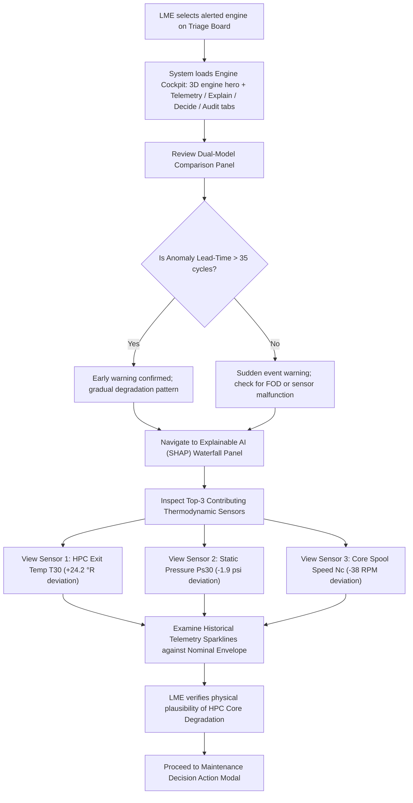
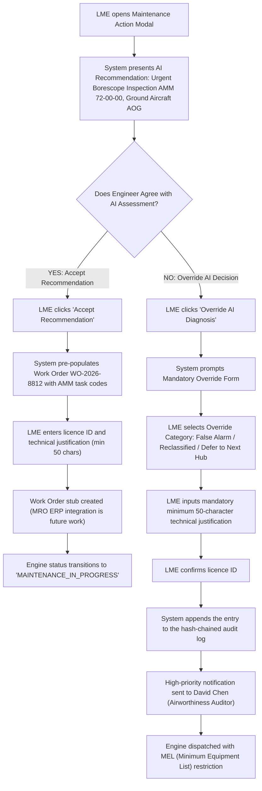
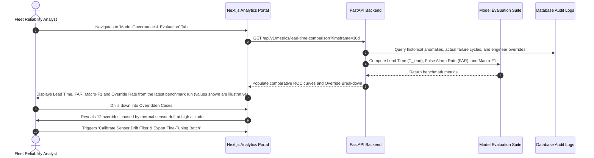

# VortexPHM-AI: Aero-Engine Telemetry Anomaly Detection & Decision Support Engine
## Comprehensive User Flows & Interaction Specifications

---

## 1. User Personas

VortexPHM-AI is designed around three primary user archetypes operating within airline technical operations:

| Persona | Role | Primary Goals | Key Pain Points |
| :--- | :--- | :--- | :--- |
| **Marcus Vance** | *Line Maintenance Engineer (LME)* | Perform fast turnaround inspections, make Go/No-Go dispatch decisions, clear fault alerts within 45-minute gate turns. | Overloaded by false alarms, lacks time to decipher complex ML models, needs clear AMM task recommendations. |
| **Dr. Elena Rostova** | *Fleet Reliability Analyst (FRA)* | Track fleet-wide wear trends, analyze recurring component degradation, monitor ML false alarm rates and model drift. | Siloed maintenance databases, difficulty correlating early sensor drift with long-term engine teardown results. |
| **David Chen** | *Maintenance Quality & Airworthiness Auditor* | Verify regulatory compliance (FAA/EASA), audit engineer overrides, ensure all maintenance actions have documented justifications. | Incomplete paper logs, lack of tamper-evident records for deferred maintenance, opaque AI decision processes. |

---

## 2. Core User Flows

> All numeric values in the flows below (scores, confidences, urgency, sensor deviations) are **illustrative**. Real values come from the benchmark and replay outputs. Temperatures are in the native dataset unit (°R); the UI may also show K.

### 2.1 Flow 1: Real-Time Telemetry Alert & Triage Flow
*Actor: Line Maintenance Engineer (Marcus Vance)*

```mermaid
sequenceDiagram
    autonumber
    actor LME as Line Maintenance Engineer
    participant UI as Next.js Dashboard
    participant API as FastAPI Backend
    participant ML as Dual-Model Inference Engine
    participant DB as System Database

    Note over LME, UI: Aircraft lands at gate; Telemetry offloaded via ACARS / Gatelink
    API->>ML: Evaluate batch telemetry (Engine SN: ENG-CFM-042)
    ML->>ML: Compute Anomaly Score (A_score = 0.84)
    ML->>ML: Classify Fault (HPC Efficiency Degradation, 91.4% confidence)
    ML->>API: Return Triage Urgency (U = 82 / 100, Tier 1 Urgent)
    API->>DB: Persist alert event and triage case
    API-->>UI: Push Real-Time Alert via SSE (polling fallback)
    UI->>LME: High-Priority Red Badge appears on Fleet Triage Board
    LME->>UI: Clicks on ENG-CFM-042 card in Urgency Queue
    UI->>LME: Displays Engine Health Cockpit with Dual-Model Summary
```

### 2.2 Flow 2: Deep-Dive Diagnostics & XAI Attribution Flow
*Actor: Line Maintenance Engineer (Marcus Vance)*



### 2.3 Flow 3: Maintenance Action Sign-off & Human Override Protocol
*Actor: Line Maintenance Engineer (Marcus Vance) & Quality Auditor (David Chen)*



### 2.4 Flow 4: Fleet-Wide Model Evaluation & Retraining Review
*Actor: Fleet Reliability Analyst (Dr. Elena Rostova)*



---

## 3. Interaction State Transitions

The state of an aero-engine within VortexPHM-AI follows a deterministic finite state machine (FSM):

```mermaid
stateDiagram-v2
    [*] --> NOMINAL : Engine Commissioned / Nominal Telemetry
    NOMINAL --> SENSING_ANOMALY : Anomaly flag set (score above calibrated threshold)
    SENSING_ANOMALY --> NOMINAL : Flags clear before persistence is reached (transient noise)
    SENSING_ANOMALY --> ACTIVE_ALERT : Flag set in >= 3 of the last 5 cycles
    
    ACTIVE_ALERT --> TRIAGE_PENDING : Dual-Model isolates fault, sets Urgency Score (Tier 1 >= 70, Tier 2 40-69, Tier 3 < 40)
    TRIAGE_PENDING --> WORK_ORDER_ISSUED : Engineer clicks ACCEPT
    TRIAGE_PENDING --> OVERRIDDEN : Engineer clicks OVERRIDE (Justified)
    TRIAGE_PENDING --> DEFERRED : Engineer clicks DEFER (1 Leg max)
    
    WORK_ORDER_ISSUED --> IN_MAINTENANCE : Hangar crew starts inspection
    IN_MAINTENANCE --> POST_MAINTENANCE_TEST : Component washed / replaced
    POST_MAINTENANCE_TEST --> NOMINAL : Telemetry verifies baseline recovery
    
    DEFERRED --> ACTIVE_ALERT : Flight leg completed; mandatory re-inspection
```
